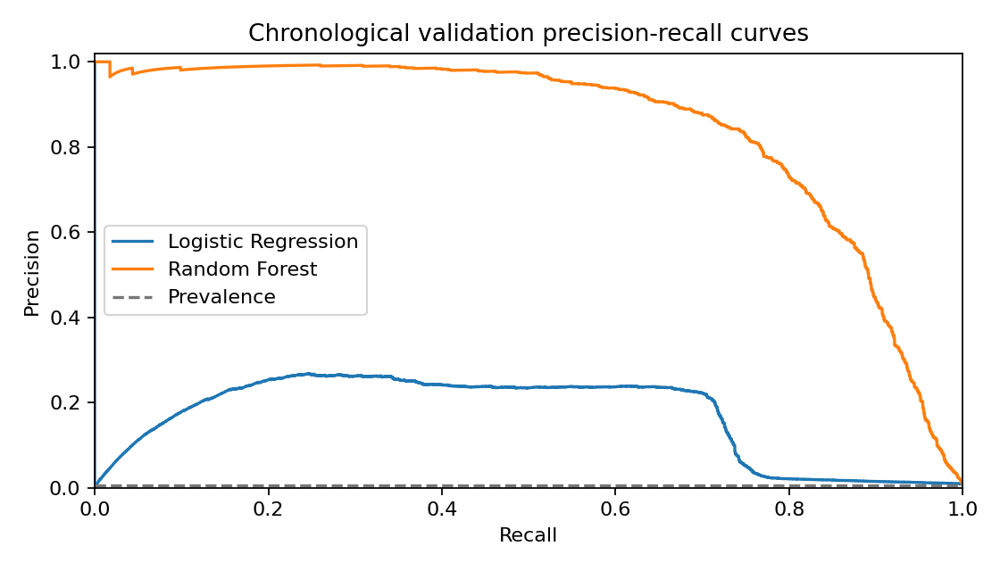
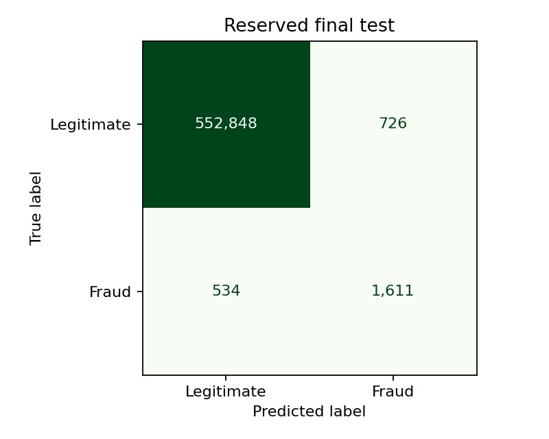

# Original baseline development results

This file preserves the original Random Forest experiment. New validation-only
Gradient Boosting/history results and corrected context handling are documented
in `History_Integration_Results.md` and the current executed notebook. The final-test
numbers below do not belong to either new model.

Development run: October 19, 2026.

## Status

A working full-data modeling pipeline and local demo are implemented. This is
development evidence, not a claim that the instructor final deliverable is complete.
The earlier Part II report/notebook are preserved unchanged.

## Data and experiment

- Original development: 1,296,675 transactions; no card sampling.
- Training: 1,037,340; chronological validation: 259,335.
- Reserved official test: 555,719 transactions, including 2,145 fraud cases.
- All training-only cards retained; 16 test cards were unseen in the training period.
- 78 transformed features; raw identifiers/labels are excluded.
- Time, age and customer-to-merchant distance reuse Part II shared feature functions.
- Scaling/encoding and classifier fit on training only; class weighting instead of resampling.
- Chronological split keeps the original file roles; no random 80/20 split of test.
- Source hashes, exact periods, parameters and tested environment are recorded in results/experiment.json.

## Validation comparison

| Method | Precision | Recall | F1 | Average precision | False alerts | Missed fraud |
| --- | ---: | ---: | ---: | ---: | ---: | ---: |
| Majority class | 0.00% | 0.00% | 0.0000 | 0.0059 | 0 | 1,538 |
| Amount rule | 28.02% | 47.85% | 0.3534 | 0.1897 | 1,891 | 802 |
| Logistic Regression | 23.57% | 66.38% | 0.3479 | 0.1667 | 3,311 | 517 |
| Random Forest | 73.10% | 80.04% | 0.7641 | 0.8436 | 453 | 307 |

The amount rule flags amounts above the training 99th percentile ($545.2588).
It is a simple comparison rule, not a claim about how a real bank operates.
Average precision summarizes the precision-recall curve; it is not trapezoidal PR area.

Selected model: **Random Forest**, fixed score threshold **0.576961289364**.
Maximum validation F1 subject to recall >= .80 and precision >= .10, if feasible; otherwise maximum F1.
Prefer candidates meeting both targets; then maximum validation F1, then average precision.
The estimator is not refitted on validation. Logistic Regression could not meet both targets.

## Locked final-test result

- Precision: **68.93%**; recall: **75.10%**; F1: **0.7189**.
- Average precision: 0.7799; ROC AUC: 0.9893.
- True fraud flags: 1,611; false alerts: 726; missed fraud: 534; true negatives: 552,848.
- Review workload: 0.42% of test transactions.
- Local batch pipeline scoring: 3.64 seconds for 555,719 records; excludes CSV loading, network and UI.

**The preliminary 80% recall target was NOT met on final test.** Precision exceeded
the preliminary 10% minimum, but both criteria were required. Validation performance
was better than the later-period test. We did not adjust the threshold after testing.

## Checks and limitations

- Six automated tests cover invalid values/missing columns, unknown categories,
  identity/target exclusion, threshold selection, valid upload and error-only failure responses.
- Desktop (1440 x 1000) and mobile (390 x 844) browser checks passed: sample/upload
  scoring, filtering, result download, loaded chart, clear/error states, 20 MB rejection
  and no page overflow. No JavaScript errors were observed. Human usability checks remain pending.
- The official test was opened only after the model/threshold were saved. The
  evaluation record prevents accidental reruns within the same experiment.
- Test subgroup counts/rates are recorded in results/test_subgroups.csv. Small groups
  are flagged; undefined subgroup rates remain blank, not misleading zero values.
- Class-weighted scores are not calibrated probabilities. Flags mean review, not confirmed fraud.
- Synthetic historical U.S. data, demographic/geographic proxies and repeated
  customers limit generalization. Earlier EDA exposed development patterns.
- No real banking integration, authentication, production security or independent teammate usability validation.
- Test outcomes are now observed. Future iterations must not tune on this test
  and present it as a fresh independent assessment.

## Next team work

Run teammate usability checks and follow Demo_Checklist.md. Obtain the final
instructor rubric before shaping the final report and presentation. The current
demo runs from saved artifacts without training or uploading the full datasets.

## Sources

- Dataset: https://www.kaggle.com/datasets/kartik2112/fraud-detection
- Synthetic generator: https://github.com/namebrandon/Sparkov_Data_Generation
- Threshold methodology: https://scikit-learn.org/1.5/modules/classification_threshold.html
