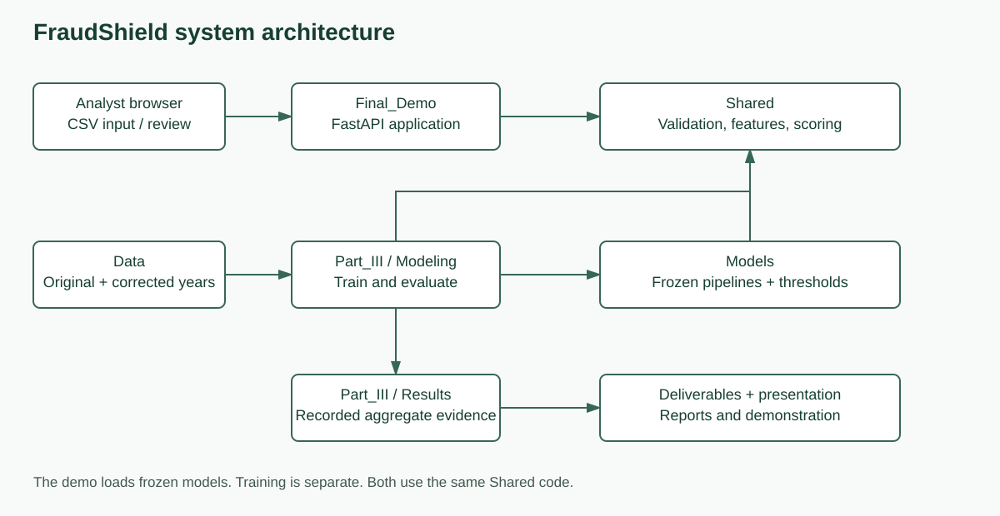
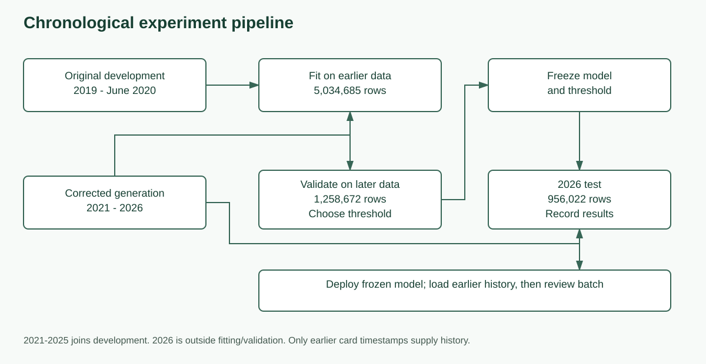

# FraudShield course project

One project, one Git repository. The authoritative Windows workspace is
`G:\1MDC_Education\CAI2820C_Artificial_Intelligence_App\01_Assignments\CAI2820C_FraudShield`.
Use this project for every phase and the final demo, not the old external copies.

## Folder map

| Folder | Purpose | Guide |
|---|---|---|
| Part_I | Initial problem and proposal | [Part I](Part_I/README.md) |
| Part_II | Preparation, submitted report, notebook and exact sample audit | [Part II](Part_II/README.md) |
| Part_III | Training, evaluation, final reports and phase references | [Part III](Part_III/README.md) |
| Final_Demo | Application, launchers and final PowerPoint | [Run locally or remotely](Final_Demo/README.md) |
| Shared | The same feature/scoring functions used by training and demo | [Shared runtime](Shared/README.md) |
| Data | Original/corrected data, upstream generator and its environment; local only | [Inventory](References/Data_and_Models.md) |
| Models | Frozen original/corrected models; local only | [Inventory](References/Data_and_Models.md) |
| References | Cross-phase roadmap, source material and diagrams | [References](References/README.md) |
| Tests | Automated checks with small fixtures | `python -m unittest discover -s Tests -v` |
| Archive | Superseded working copies, ignored by Git | [Migration record](References/Reorganization.md) |

Each phase has its own Deliverables and References. Training belongs to Part III.
The demo loads frozen models; it does not train. Shared, Data and Models have one
authoritative home because they support multiple phases.

## Architecture



## Experiment pipeline



[Diagram explanations and editable Mermaid sources](References/Architecture_and_Pipeline.md)

## Corrected final experiment

Development: **6,293,357 rows**, comprising original January 2019-June 2020 training
and corrected generated 2021-2025. Fitting uses **5,034,685** earlier rows; validation
uses **1,258,672** later rows. Corrected 2026 test: **956,022 rows**, **2,032 fraud**.

| Frozen model on the same 2026 rows | Precision | Recall | F1 | Accuracy | False alerts | Missed fraud |
|---|---:|---:|---:|---:|---:|---:|
| Expanded Random Forest | 42.84% | 81.84% | 56.24% | 99.7293% | 2,219 | 369 |
| Expanded transaction-only boosting | 47.54% | 83.32% | 60.54% | 99.7691% | 1,868 | 339 |
| Boosting with 17 history features | 95.33% | 86.42% | 90.66% | 99.9621% | 86 | 276 |

Boosting uses scikit-learn HistGradientBoostingClassifier. The history threshold
0.9609706329345121 was selected on validation. Read the
[executed notebook](Part_III/Modeling/Team_A_Final_Evaluation_2026_ran.ipynb),
[aggregate evidence](Part_III/Results/corrected_2026/) and
[generator correction](Part_III/References/Generator_Fix.md).

Adding the 17 strictly earlier per-card history features raised precision from 47.54% to 95.33% and recall from 83.32% to 86.42%. False alerts fell from 1,868 to 86, and missed fraud fell from 339 to 276. Fraud in the Sparkov generator is created in a one-day window, so the history features may partly exploit that pattern, and these gains should not be read as real-world performance.

The earlier generated data had upstream sampler defects. Those metrics are
historical, not final. Regeneration followed investigation of the earlier test,
so the regenerated chronological test is not independent of the entire development
history. Models and thresholds were frozen before corrected-test scoring.
All data are synthetic; scores are uncalibrated and flags require human review.
The original Kaggle-only RF result remains separate: 555,719 test rows, 68.93%
precision and 75.10% recall.

## Run the demo

Use Python 3.12 and install the environment from project root:

```powershell
python -m pip install -r requirements-tested.txt
```

Double-click [START_DEMO_LOCAL.bat](Final_Demo/START_DEMO_LOCAL.bat) for
http://127.0.0.1:8766. For the presentation, use
[START_DEMO_REMOTE.bat](Final_Demo/START_DEMO_REMOTE.bat) and the existing
external 5100 -> internal 5001 forwarding. Planned address:
http://b2518067.eero.online:5100. Stop the TTS/STT demo before sharing that port.
The launcher does not enable forwarding or change the firewall.
[Full launch and preloading instructions](Final_Demo/README.md).

Datasets and model binaries stay local; a Git clone alone cannot score transactions.
See [Part III reconstruction](Part_III/README.md) for the trusted customer-file
handoff and clean-workspace pipeline. Saved aggregate evidence remains readable
without training or evaluation. The [final forms](Part_III/Deliverables/) still
mark missing personal team reflections. Proposed monitoring and post-test
look-back recovery are not implemented real-time detection capabilities.

## Reorganization verification

November 2: Git history was preserved; model binaries, thresholds and recorded
2026 results did not change. All **52 software tests** and the three saved-model
example checks passed. No project model was retrained and 2026 was not rerun.
[Verification record](Part_III/Results/reorganization_verification.json).
