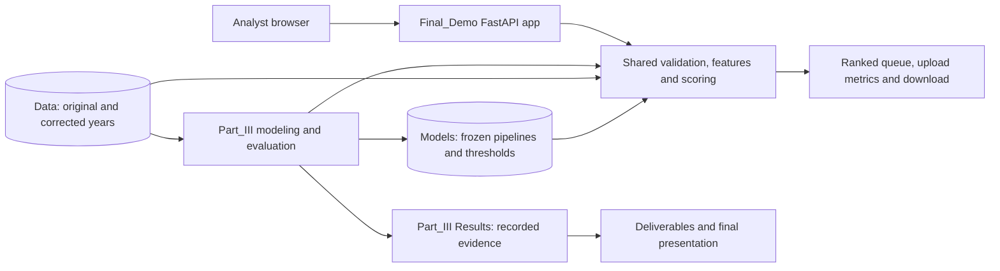
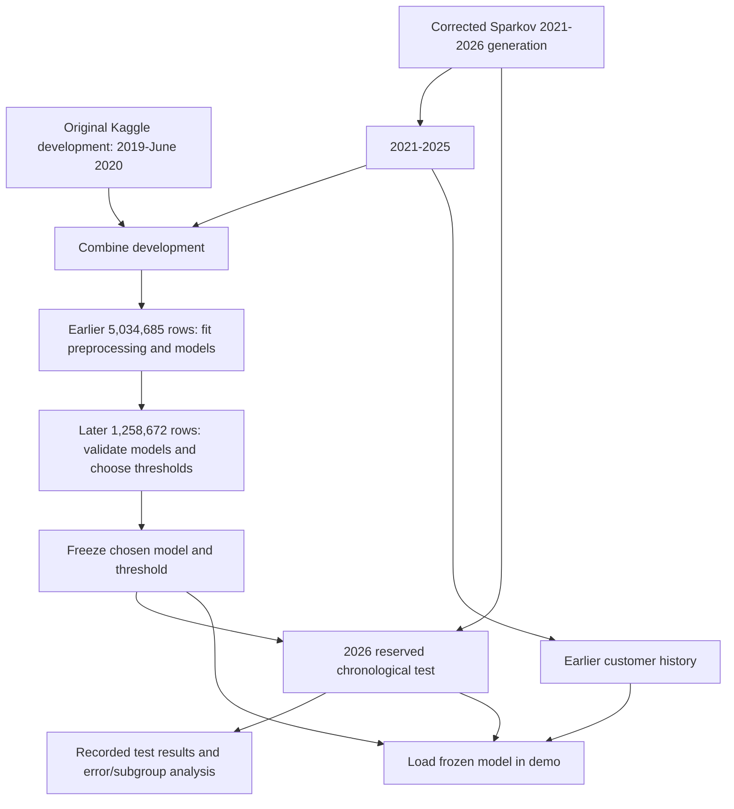

# Architecture and experiment pipeline

## Architecture

The demo loads saved models. Training is separate. Both use the same feature code.
Card identifiers connect histories; labels and numeric IDs are not predictors.
Data and Models stay local; code, notebooks and aggregate evidence are published.
Monitoring, analyst case management and retraining schedules are proposed future
operations, not implemented services in this diagram.

## Pipeline

The original Kaggle test is not part of expanded development. At scoring time,
each transaction sees only strictly earlier timestamps on the same card, including
earlier review rows. A later flag cannot retroactively change the model's earlier
prediction. The exploratory look-back rule is delayed recovery, not this pipeline's
immediate detection rate. The generator correction followed inspection of the
earlier defective test, which is disclosed in the evaluation history.

Standalone SVG versions are in Diagrams for local viewing and reuse.
